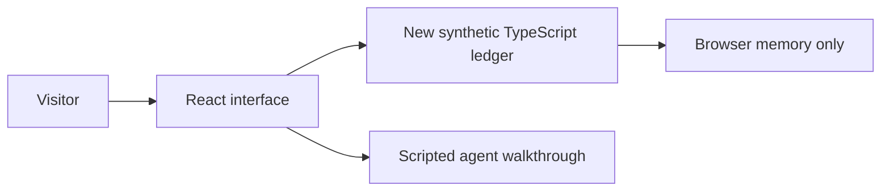

# ATHEUR

### Multi-Agent AI Market Intelligence & Trading Platform

An interactive software engineering portfolio by **Michael Mochulla**, independent developer of Atheur. Explore a safe, standalone reconstruction of the command center while the original engine and decision logic remain proprietary.

**[Launch the interactive demo](https://mjmochulla-bot.github.io/atheur-public-showcase/)** — public, browser-only and entirely synthetic.

## What you can try

- Synthetic BTC, ETH and SOL charts with adjustable history and simulation controls.
- Session cash, equity, paper buys, position closes, total allocation controls, stop-losses and take-profits.
- A decision walkthrough comparing an eligible candidate, a risk veto and inconclusive evidence.
- Step-by-step Scout → Risk Analyst → Coordinator explanations, without private rules.
- Session analytics, configuration health, high-level architecture and a proposed learning roadmap.
- Responsive layouts, keyboard-accessible controls and reduced-motion support.

## Current learning architecture

The private platform captures public observations into a persistent Python research service, evaluates experiments chronologically with cost modeling, and stores reports and recovery checkpoints locally. Research candidates do not automatically enter the active paper strategy. The review agents are deterministic Python components, not three LLM services.

The [learning architecture and roadmap](docs/LEARNING_ARCHITECTURE.md) distinguishes implemented private-system responsibilities from proposed work: versioned research artifacts, independent evaluation, an audited research-to-paper gate, isolated observable workers and optional bounded language explanations. Proposed work is not represented as complete.

## Technology and architecture

This showcase uses React, TypeScript, Vite, original SVG charts, Lucide and Vitest. It requires no backend or API credentials.



Verified private project components include Python/Tkinter desktop, React/TypeScript/Vite web terminal, FastAPI, local SQLite records and an Expo/React Native iOS companion. The original is a local paper-research system; no live trading capability is claimed.

## Run locally

Node 24 and pnpm 11.25.0:

```sh
pnpm install --frozen-lockfile
pnpm test
pnpm run build
pnpm run audit:source
pnpm dev
```

Refresh resets the session. Production CSP disables network connections; development hot reload may be blocked, so refresh after edits. Use `pnpm preview` to test the production output. Relative asset paths support the GitHub Pages project path.

## Deployment

The manual [Pages workflow](.github/workflows/pages.yml) runs tests, a build and a source/history scan. Configure Pages to use GitHub Actions and run it with `PUBLISH-SYNTHETIC-SHOWCASE`. Only `dist` is deployed. See [publication notes](docs/PUBLISHING.md).

## Intellectual property and simulation limits

Only newly written showcase code is included. The private engine, strategies, agent rules, credentials, account records and executables are excluded. Public browser assets are inspectable and copyable; a private original repository and copyright notice do not hide deployed JavaScript.

This educational simulation is not investment advice, a financial service or a claim of profitability. All prices and results are synthetic. Long spot simulation excludes fees, liquidity and slippage; protective exits occur at the next synthetic quote. Results do not predict real trading outcomes.

Copyright © 2026 Michael Mochulla. All rights reserved. No redistribution license is granted for the original proprietary platform.
