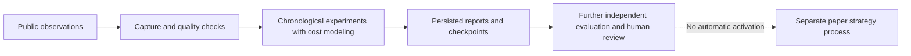

# Learning architecture and proposed roadmap

## Current private architecture

The existing platform's learning service is a persistent, paper-only research process in the Python/FastAPI backend. It captures public trades and bid/ask observations and stores research sessions, checkpoints and experiment reports locally. A closed browser does not stop the process. Saved sessions recover when the backend restarts; data capture requires the host to stay running.

Experiment evaluation separates earlier training, subsequent validation and held-out observations chronologically. Reports model trading costs, including fees, spread and slippage. Insufficient data is inconclusive. A positive experimental result does not establish statistical significance or future profitability.

The researcher cannot automatically approve, promote or activate a strategy. Research and the active paper loop are separate responsibilities. Scout, Risk Analyst and Coordinator are deterministic Python components associated with paper review; describing them as three LLMs would be inaccurate. Experimental search is not presented as model training or reinforcement learning.

This description was checked against the private repository's current README and learning documentation. No private parameter values, selection rules, environment variable names, database paths, prompts, experimental results or source code are reproduced here.

## Proposed future architecture — not implemented

1. Versioned datasets and experiment artifacts with reproducible evaluation reports.
2. Evaluation across independent time windows and market conditions, leakage checks, uncertainty reporting and explicit inconclusive states.
3. A separately audited research-to-paper promotion gate with human review, controlled paper evaluation and rollback.
4. Isolated capture and experiment workers, explicit job lifecycle and recovery evidence, observability and resource budgets.
5. An optional language explanation layer grounded in approved structured evidence, without authority to alter risk or submit orders.

These are proposed engineering directions, not claims of existing capabilities or promised delivery. No live-trading integration is promised.

## Public showcase boundary

The public app contains no learning backend. Prices are generated locally, agent explanations are scripted, and paper state is held only in browser memory. The proprietary engine, research logic and production data remain excluded.
